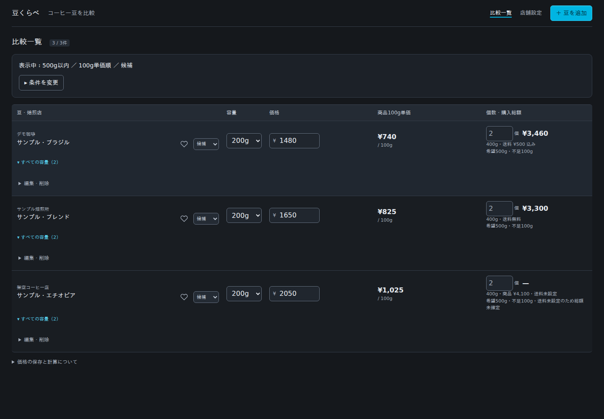

# コーヒー豆比較

異なる焙煎店・銘柄のコーヒー豆を、100g単価と送料込みの購入総額で比較する個人用アプリです。各自のサーバーに導入し、PCとAndroidから同じデータを閲覧・更新します。

店舗・豆・容量別価格を手入力で登録し、一覧から価格を編集できます。Go、静的ビルドしたSvelte/TypeScriptの画面、SQLiteで動作します。本番ではNode.jsや別のDBサーバーを常駐させません。



[スマホ幅の画面例](docs/images/comparison-mobile.png)もあります。画面例は架空データを使い、Chromiumで表示したものです。Android実機での動作は未検証です。

- [使い方](#使い方)
- [自分のPCで試す](#自分のpcで試す)
- [サーバーへ導入する](#サーバーへ導入する)
- [認証と保存データ](#認証と保存データ)
- [更新と切り戻し](#更新と切り戻し)
- [バックアップと復元](#バックアップと復元)
- [開発と検証](#開発と検証)
- [制限と問い合わせ](#制限と問い合わせ)
- [ライセンス](#ライセンス)

## 使い方

「＋ 豆を追加」から豆名・店舗・最初の容量と価格を登録します。商品URLは任意です。既存店舗は検索して選択でき、新しい店舗は豆と一緒に作成します。

送料と「送料無料（円）」は店舗設定から編集します。送料無料になるかどうかは、その豆1種類について、選択した容量の価格×個数で判定します。送料の空欄は未設定、0は0円です。

最初は候補の豆を100g単価順に表示します。「条件を変更」で検索・並び順・予算・袋の容量範囲・購入量を編集し、「この条件で比較」で最新価格の取得と比較をまとめて行います。

価格や個数の編集中は金額だけを更新し、行順と表示対象を保ちます。並べ替えや絞り込みにも再度この比較操作を使います。

購入量を指定すると、容量範囲内で希望量を超えず、個数上限999を満たす最も大きい袋を選びます。その袋だけで希望量を超えない個数を試算し、不足量を表示します。500g希望で100g袋と200g袋があれば、200gを2個選び、不足100gです。

最安や希望量への近さは保証しません。異なる容量の袋も組み合わせません。送料が不明な豆は総額を未確定とし、予算を指定しても一覧に残します。

価格はフォーカスを外すかEnterで自動保存します。通信失敗や競合では入力を保持し、「再試行」や保存先の値を確認する操作で復旧します。保存先が削除済みなら、その下書きを破棄して一覧へ戻れます。

豆を「候補」「候補外」に分け、「また買いたい」をハートで記録できます。ハートは候補状態とは別に保存します。豆・容量を削除するときは確認があり、豆を消すと全容量も消えます。豆が残る店舗は削除できません。

## 自分のPCで試す

LinuxまたはWSLで、[go.mod](go.mod)の`toolchain`に指定したGo、gcc、Node.js・npmを用意します。Node.jsは22.17以上の22系または24以上です。GoをPATHに設定し、cloneしたリポジトリの直下で次のコマンドを実行します。

```sh
npm ci --prefix frontend
npm --prefix frontend run build
CGO_ENABLED=1 go run ./cmd/coffee
```

`http://127.0.0.1:3180`を開きます。認証なしで、自分のPCだけで試せる構成です。Ctrl+Cで終了しても、データは`data/coffee.sqlite`に残ります。PCとAndroidで共有する場合は、次のHTTPS構成を使います。

## サーバーへ導入する

Docker Engine・Compose v2・Gitと、PC・Androidの両方から接続できるHTTPS URLを用意します。対象は個人用のLAN・私設ネットワークです。

```text
PC / Android → HTTPSプロキシ → 127.0.0.1:3180 → Coffeeコンテナ
```

1. GitHubの「Code」からこのリポジトリのHTTPS URLをコピーし、`REPOSITORY_URL`を置き換えてcloneします。

   ```sh
   git clone REPOSITORY_URL coffee-comparison
   cd coffee-comparison
   cp .env.example .env
   ```

2. `.env`の`COFFEE_ORIGIN`を実際のHTTPS originへ変更します。例は`https://coffee.example.com:8443`です。末尾のスラッシュやパスは付けません。3180番が使用中なら`COFFEE_PORT`とプロキシの接続先を同じ未使用ポートへ変更します。その他の設定は[.env.example](.env.example)を参照してください。
3. メモリ・ディスクの空き、使用するポート、既存サービスの状態を確認します。そのあと、次のコマンドで設定を確認し、ビルド・初回の認証設定・起動を行います。ビルドにはネットワーク接続が必要です。実行コンテナのメモリ・CPU制限はビルドには適用されません。

   ```sh
   docker compose config --quiet
   docker compose build
   docker compose --profile tools run --rm setup
   docker compose up -d --no-build --wait coffee
   docker compose exec -T coffee coffee healthcheck
   ```

   `setup`は初回だけ実行します。ユーザー名は`coffee`です。生成されたパスワードは標準出力に一度だけ表示されます。パスワード管理ツールへ保存し、ログ・チャット・Gitへ貼らないでください。このコマンドは認証DBに平文パスワードを保存せず、既存ファイルも上書きしません。
4. HTTPSプロキシを設定します。[Nginx設定例](deploy/nginx.conf.example)の待受アドレス・ホスト名・証明書と秘密鍵のパス・転送先を変更し、既存の`http`コンテキスト内へ追加します。設定例は単独の`nginx.conf`ではありません。Tailscaleを使う場合は下の手順も選べます。

   - PC・Androidの両方で、同じホスト名がプロキシのLANアドレスに解決され、ブラウザーが証明書を信頼できるようにします。私設CAを使う場合も、両端末でそのCAを信頼するように設定します。
   - Nginx例の既定の待受は`127.0.0.1:8443`です。他端末から使う場合はプロキシ側をLANアドレスへ変更します。アプリのHTTP公開はループバック限定のままにします。
   - `/`・`/assets/`・`/api/`・`/auth/`は同じHTTPS originからアクセスできるようにし、転送時にHostをポート込みで保持します。Origin・Authorization・Cookieも転送し、Originを固定値へ書き換えません。ブラウザーのURLと`COFFEE_ORIGIN`を一致させます。
   - 既存プロキシの設定と待受の差分を確認して退避し、Nginxなら`nginx -t`の成功後に設定を読み直します。問題があれば追加設定を取り消します。公開インターネットへのポート開放はこの構成の前提ではありません。

5. 両端末から同じHTTPS URLを開き、証明書警告なしでログインします。一方の端末で登録と価格保存を行い、もう一方で再比較して同じ値が見えることを確認します。再読込・コンテナ再起動後の保存値と、同時編集時の競合表示も確認してください。

healthの成功はHTTPSや実機接続の成功を示しません。状態の確認には`docker compose ps`と`docker compose logs --tail=50 coffee`を使えます。

<details>
<summary>Tailscale Serveを使う場合</summary>

対象サーバーとPC・Androidが同じtailnetへ接続できることを確認し、`COFFEE_ORIGIN`を実際のServeのHTTPS originへ合わせます。

操作前に`tailscale serve status`と`ss -ltn`で競合を確認し、`tailscale serve status --json`をリポジトリ外へ保存します。未使用の8443番へ経路を追加する例です。

```sh
sudo tailscale serve --bg --https=8443 http://127.0.0.1:3180
tailscale serve status
```

`COFFEE_PORT`を変えた場合は転送先も合わせます。既存経路を維持し、必要なtailnet内のアクセス権を確認して、両端末からログインと保存を試します。追加した経路を取り消すには、次を実行します。

```sh
sudo tailscale serve --bg --https=8443 off
tailscale serve status
```

既存設定をまとめて消す`reset`や、外部公開するFunnelは使用しません。[Serve公式資料](https://tailscale.com/docs/reference/tailscale-cli/serve)も確認してください。

</details>

## 認証と保存データ

ログインはログイン時点から30日間有効で、認証DBが残れば再起動後も継続します。店舗設定の「この端末からログアウト」でそのブラウザーのセッションを失効させます。

パスワードを忘れた場合や全端末のセッションを失効させたい場合は、次を実行して新しいパスワードを管理ツールへ保存します。

```sh
docker compose --profile tools run --rm --no-deps setup reset-password -db /config/auth.sqlite
```

任意のパスワードは`-password-stdin`で標準入力から指定できます。12文字以上・UTF-8で512バイト以内とし、引数・`.env`・Composeへ値を書きません。

| 保存先 | 既定のボリューム名 | 内容 |
| --- | --- | --- |
| `/data` | `coffee-comparison_data` | 店舗・豆・容量別価格・候補状態・ハート |
| `/config` | `coffee-comparison_config` | 認証DB・ログインセッション |
| `/backups` | `coffee-comparison_backups` | 商品DBのバックアップ |

表のデータはGitやソースコードと別に保存します。既存環境を更新したり、ソースの取得先を変更したりする場合は、`.env`・実際のComposeプロジェクト名・各ボリューム名を維持してください。`-p`や`COMPOSE_PROJECT_NAME`の指定がある場合、既定名とは異なります。`docker compose down -v`やvolume pruneで保存ボリュームを削除しないでください。

商品DBのバックアップには認証DBを含めません。豆の復元では認証ボリュームを引き継げます。認証ボリュームを失った場合は初期設定からやり直し、全端末で再ログインします。

## 更新と切り戻し

起動時に商品DBを自動移行するため、旧イメージと更新前のバックアップを残します。同じ配備ディレクトリでの並行更新は避け、`UNIQUE`を毎回異なる日時などへ置き換えます。旧`auth.json`の利用者はこの節の末尾にある移行手順を先に確認してください。

```sh
git status --short
docker image tag "$(docker compose images -q coffee)" coffee-comparison:rollback-UNIQUE
git pull --ff-only
docker compose build
docker compose stop coffee
COFFEE_IMAGE=coffee-comparison:rollback-UNIQUE docker compose run --rm --no-deps coffee backup -db /data/coffee.sqlite -out /backups/pre-update-UNIQUE.sqlite
docker compose up -d --no-build --wait coffee
```

未保存のローカル変更がある場合は更新前に扱いを確認します。ビルドに失敗した場合は切り替えません。バックアップに失敗した場合は`COFFEE_IMAGE=coffee-comparison:rollback-UNIQUE docker compose up -d --no-build --wait coffee`で旧イメージを再開します。`.env`の`COFFEE_IMAGE`を変更している場合も、最後の起動が新版を指すことを確認してください。

更新後はHTTPSでログイン・表示・保存を確認します。切り戻す場合はアプリを止め、更新前のスナップショットを新しいボリュームへ[復元](#バックアップと復元)します。`.env`の`COFFEE_DATA_VOLUME`を復元先、`COFFEE_IMAGE`を保存した旧イメージへ変更して起動します。失敗した元ボリュームは調査用に残します。コードだけを戻して旧版で新しいスキーマのDBを開かないでください。更新後の入力を失う可能性も確認してください。

<details>
<summary>旧auth.jsonから移行する場合</summary>

新規導入では不要です。旧JSONを使っている場合、新しい`setup`を重ねて実行しません。移行前に従来のパスワードを管理ツールへ控えます。

1. コード更新前に旧Compose設定・稼働中のイメージ・商品DBを保存します。同じディレクトリで作業し、`.env`とプロジェクト名を維持します。

   ```sh
   cp compose.yaml /tmp/coffee-before-auth-UNIQUE.compose.yaml
   docker image tag "$(docker compose images -q coffee)" coffee-comparison:before-auth-UNIQUE
   docker compose exec -T coffee coffee backup -db /data/coffee.sqlite -out /backups/pre-auth-UNIQUE.sqlite
   ```

   バックアップ失敗時は中止します。Compose設定は再起動で消えない保護された場所にも保管します。
2. 新版コードを取得してビルドし、`docker compose stop coffee`で停止します。同じ認証ボリューム内で移行します。

   ```sh
   docker compose --profile tools run --rm --no-deps setup migrate-credentials -from /config/auth.json -out /config/auth.sqlite
   docker compose up -d --no-build --wait coffee
   ```

3. 従来の認証情報でログインし、保存・再読込・再起動後の継続を確認してから旧平文ファイルを削除します。移行コマンドは元JSONと既存出力を上書きしません。

   ```sh
   docker compose --profile tools run --rm --no-deps --entrypoint /bin/rm setup /config/auth.json
   ```

旧JSONを残した状態なら、旧Compose設定と旧イメージで戻せます。

```sh
COFFEE_IMAGE=coffee-comparison:before-auth-UNIQUE docker compose --project-directory "$PWD" -f /tmp/coffee-before-auth-UNIQUE.compose.yaml up -d --no-build --wait coffee
```

旧JSONの削除後は旧版用の認証設定を再用意する必要があります。平文のコピーやバックアップも確認し、不要なものを整理します。ファイル削除はストレージ上の安全消去を保証しません。

</details>

## バックアップと復元

稼働中でも、WALの確定済みデータを含む一貫した商品DBスナップショットを作れます。バックアップ処理で検証してから0600で保存し、既存出力は上書きしません。`UNIQUE`は毎回変更します。

```sh
docker compose exec -T coffee coffee backup -db /data/coffee.sqlite -out /backups/manual-UNIQUE.sqlite
mkdir -p backups
docker compose cp coffee:/backups/manual-UNIQUE.sqlite backups/manual-UNIQUE.sqlite
chmod 600 backups/manual-UNIQUE.sqlite
```

保護された別ホストにもコピーします。同じディスクのボリュームだけではディスク故障に備えられません。定期実行する場合は、既存のスケジューラーに上記コマンドを登録し、作業ディレクトリとDocker操作権限を設定します。付属構成だけではバックアップの定期実行や世代削除は設定されません。

復元演習では毎回新しいデータボリューム名を使い、本番を上書きしません。

```sh
COFFEE_DATA_VOLUME=coffee-restore-UNIQUE docker compose run --rm --no-deps coffee restore -from /backups/manual-UNIQUE.sqlite -db /data/coffee.sqlite
```

内容と書き込みを確認するには、同じ復元先を使って未使用ポートで一時起動します。

```sh
COFFEE_DATA_VOLUME=coffee-restore-UNIQUE COFFEE_ORIGIN=https://coffee-restore.example.com:8444 docker compose run --rm --no-deps -p 127.0.0.1:3181:3180 coffee
```

例の名前とポートを自分の演習用へ変更し、独立した一時HTTPSプロキシから3181番へ転送します。Host・`COFFEE_ORIGIN`・証明書を合わせてログイン・保存を確認し、Ctrl+Cで停止します。HTTPポートへ直接ブラウザー接続して本番ログインする構成ではありません。認証ボリュームは共有するため、演習でパスワード再設定は行いません。

## 開発と検証

Git・Bash・makeと、[試用](#自分のpcで試す)と同じツールを使います。Goのバージョンは[go.mod](go.mod)、Node.jsは[package.json](frontend/package.json)を参照してください。

```sh
npm ci --prefix frontend
make check
```

`bash scripts/check.sh`でも同じ検証を実行できます。Goの整形・依存整合性・vet・race付きテスト・ビルドと、フロントエンドの整形・型検査・単体テスト・静的ビルド・差分確認を行います。ソースは自動修正しません。画面を変更しながら確認する場合は、Goを起動した別ターミナルで`npm --prefix frontend run dev`を実行します。

ブラウザー検証にはChromiumと必要な共有ライブラリ・日本語フォントを用意します。

```sh
PLAYWRIGHT_BROWSERS_PATH="$PWD/.tools/playwright" frontend/node_modules/.bin/playwright install chromium --only-shell
make e2e
```

`make e2e`は一括検証後に一時DBを使って3189番でアプリを起動し、PC・スマホ幅でブラウザー操作を検証します。`COFFEE_E2E_PORT`でポートを変えられます。終了時にサーバーと一時DBを片付け、通常の`data/`は使用しません。失敗時のトレースは`frontend/test-results/`へ出力します。[CI](.github/workflows/check.yml)も同じ検証を行い、デプロイは行いません。実機接続・HTTPS・復元・定期バックアップは配備先で確認してください。

## 制限と問い合わせ

- 個人用のLAN・私設ネットワークが対象です。公開インターネット向け運用、一般向け共有サービス、複数ユーザーには対応していません。
- 商品URLは保存できます。商品名・画像の取り込みや価格の自動収集は未実装です。
- 店頭の交通費・移動時間、購入履歴、異なる容量や複数銘柄を組み合わせた購入の最適化は未実装です。
- 比較条件・選択容量・購入個数・下書きはページ内だけの設定で、再読込で失われます。店舗・豆・価格・候補状態・ハートはサーバーに保存します。
- 店舗・豆の登録成功応答を失った場合は、重複する可能性があります。削除の取り消しと、豆の所属店舗変更は提供していません。
- HTTPSの独立originのルートパスで配備します。サブパスには対応していません。

不具合は既存Issueを確認し、再現手順・期待した結果・実際の結果・実行環境を添えて報告してください。PRには目的と検証結果を記載し、動作を変更した場合はその説明も更新します。認証情報・DB・個人データ・実環境のログは添付しません。

脆弱性はGitHubの「Report a vulnerability」が利用できる場合に非公開で報告してください。利用できなければ、詳細を書かず非公開連絡経路を求めるIssueで連絡します。機密情報や悪用手順は公開Issue・PRへ投稿しません。認証情報の漏えい時は接続経路を制限し、[パスワードを再設定](#認証と保存データ)して全セッションを失効させます。保守期限や応答時間の保証はありません。

## ライセンス

プロジェクト本体のライセンスは未設定です。主要な第三者コードの表示は[THIRD_PARTY_NOTICES.md](THIRD_PARTY_NOTICES.md)を参照してください。この表示はGo・go-sqlite3・Svelteと、画面の実行コードに含まれる依存物を対象に、2026-10-24に確認した記録です。全配布形態の監査完了を示すものではありません。イメージやバイナリを配布する場合は、OSパッケージ等を含め実際の同梱物と必要な表示を追加確認してください。
